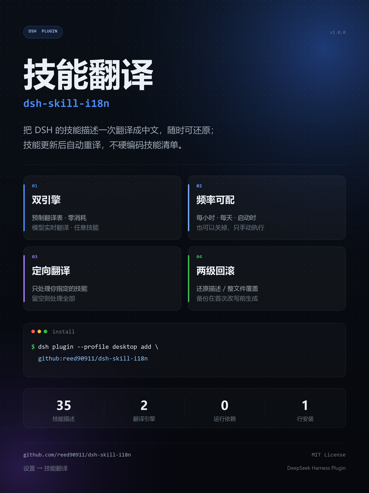

# dsh-skill-i18n

自动把技能描述（`SKILL.md` frontmatter 的 `description`）翻译成中文，带设置页、可切引擎、频率可配、支持指定技能与两级回滚。

当前版本 2.0.0。

## 安装

### 方式一：从 GitHub 安装（推荐）

```powershell
dsh plugin --profile <你的 profile> add github:reed90911/dsh-skill-i18n
```

把 `<你的 profile>` 换成实际的 profile 名，通常是 `desktop` 或 `web`。
查看现有 profile：

```powershell
dir ~\.dsh\profiles
```

安装完成后**重启 DSH**，左下角 ⚙ 设置里会出现「技能翻译」。

### 方式二：从本地目录安装（适合改代码）

```powershell
git clone https://github.com/reed90911/dsh-skill-i18n.git
dsh plugin --profile desktop add C:\path\to\dsh-skill-i18n
```

这种方式下修改代码后，执行一次插件热重载即可生效，不需要重新安装。

### 方式三：下载压缩包安装（网络受限时）

有些网络环境下 `git clone` 会失败（报 `Connection was reset` 或 `Could not connect to server`），这时直接下载压缩包绕过 git 协议：

```
https://codeload.github.com/reed90911/dsh-skill-i18n/tar.gz/refs/heads/main
```

解压并安装：

```powershell
cd 下载目录
tar -xzf dsh-skill-i18n-main.tar.gz
dsh plugin --profile desktop add .\dsh-skill-i18n-main
```

注意两点：

- 解压后的目录名通常是 `dsh-skill-i18n-main`，安装时指向它，里面要有 `package.json`
- 换版本时重新下载再装一次即可，pnpm 会覆盖旧链接

如果连 codeload 也访问不了，可以让能访问的朋友下载后把目录发给你，再执行同一条安装命令。

### 卸载

```powershell
dsh plugin --profile desktop remove dsh-skill-i18n
```

卸载前建议先把技能描述还原，否则被翻译过的描述会留在文件里：

```
skill_i18n({ action: "restore", fromBackup: true })
```

也可以直接删除数据目录 `~/.dsh/skill-i18n/`（配置、状态与备份都在这里）。

### 运行要求

| 项目 | 要求 |
|---|---|
| DSH | 支持 bundle 插件与 `settings.section` 插槽的版本 |
| Node | >= 20 |
| 网络 | 仅「模型实时翻译」需要；预制翻译表完全离线 |

## 仓库结构

| 文件 | 用途 | 安装后可否删除 |
|---|---|---|
| `index.js` | Host 半：调度、翻译、HTTP 接口、`skill_i18n` 工具 | ❌ 必需 |
| `client.js` | Client 半：设置页 | ❌ 必需 |
| `cordis.patch.yml` | 挂载补丁，告诉 DSH 怎么加载本插件 | ❌ 必需 |
| `package.json` | 包清单（名称、入口、`dsh` 声明） | ❌ 必需 |
| `README.md` | 本说明 | ✅ 可删 |
| `LICENSE` | MIT 许可证 | ✅ 可删 |
| `.githooks/pre-commit` | 提交前敏感信息检查（**开发用**） | ✅ 可删 |
| `scripts/sensitive-scan.mjs` | 敏感信息扫描器（**开发用**） | ✅ 可删 |
| `.gitignore` / `.gitattributes` | git 配置（**开发用**） | ✅ 可删 |
| `docs/` | 海报与配图（**文档**） | ✅ 可删 |

前四项是运行必需的，删掉任意一个插件都加载不起来。后六项只服务于仓库维护——从 GitHub 或压缩包安装时会一并带上，装好之后删掉不影响插件工作。

## 海报

| 文件 | 用途 |
|---|---|
| `docs/poster-v1-original.png` | **最初宣传海报**（v1.0.0），介绍插件能力：双引擎、频率可配、定向翻译、两级回滚 |
| `docs/poster-v2-update.png` | **v2.0.0 更新内容报告**，列出这次修复的四个重点：还原可信、换行安全、配置生效、写入可靠 |



更新内容报告：[docs/poster-v2-update.png](docs/poster-v2-update.png)

## 设置页

安装后出现在 **设置 → 技能翻译**（`settings.section`，order 90）。

页面能力：

| 区域 | 作用 |
|---|---|
| 翻译引擎 | 预制翻译表 / 模型实时翻译，开关切换，即时保存 |
| 扫描频率 | 每小时 / 每天 / 仅启动时 / 关闭 / 自定义分钟 |
| 只翻译指定技能 | 逗号分隔，留空 = 全部；同时作用于自动翻译与操作按钮 |
| 操作 | 立即翻译 / 强制重译 / 还原为英文 / 整文件回滚 |
| 当前状态 | 技能数、中英分布、已记录、已备份、预制表覆盖、待翻译列表 |

配置写入 `~/.dsh/skill-i18n/settings.json`，改动**立即生效**（Host 每分钟检查一次，按当前设置判断是否到点，不需要重启）。

优先级：`settings.json` > `cordis.patch.yml` 的 config > 内置默认值。设置页保存过的键以 `settings.json` 为准；patch 里的值只在 `settings.json` 没有该键时生效。

## 两种翻译引擎

| 引擎 | 优点 | 代价 |
|---|---|---|
| `glossary`（默认） | 零消耗、结果稳定、措辞紧凑 | 只覆盖内置 35 个技能；表外技能跳过并提示 |
| `llm` | 任意技能、新技能自动处理、贴近原文结构 | 每条 50–80 tokens，35 个约 2–3k tokens |

翻译走 DSH 的 `llm` 服务（默认模型）。`translator` 服务在部分安装里只有类型定义、没有实现，插件会检测并回退。

## 两级回滚

| 方式 | 范围 |
|---|---|
| `restore` | 只把 `description` 写回原文，文件其它内容不动 |
| `restore({ fromBackup: true })` | 用 `~/.dsh/skill-i18n/backup/<技能>/SKILL.md` 覆盖整个文件 |

备份在**首次改写前**创建，之后不覆盖，所以永远是最初版本。

## 工具接口

```
skill_i18n({ action: "status" })
skill_i18n({ action: "translate", skills: ["resume-tailor"] })
skill_i18n({ action: "translate", force: true })
skill_i18n({ action: "restore", fromBackup: true })
```

## 数据位置

```
~/.dsh/skill-i18n/settings.json   设置页写入
~/.dsh/skill-i18n/state.json      原文 / 译文 / 是否已还原
~/.dsh/skill-i18n/backup/         整文件备份
```

## 提交前的敏感信息扫描

仓库自带一个 pre-commit 钩子：提交前只扫描**本次暂存的文件**，命中手机号、邮箱、各类密钥就阻止提交。

克隆后启用一次：

```sh
git config core.hooksPath .githooks
```

被拦截时的输出示例：

```
┌──────────────────────────────────────────────────────────────┐
│  提交被拦截：待提交文件里发现疑似敏感信息                     │
└──────────────────────────────────────────────────────────────┘

文件：config.js
  ⚠ 发现 1 处疑似敏感信息（样例已脱敏）：
    [密钥赋值] config.js  x1  api***yz
```

也可以单独手动跑：

```sh
node scripts/sensitive-scan.mjs .           # 扫描整个目录
node scripts/sensitive-scan.mjs src/a.js    # 扫描单个文件
node scripts/sensitive-scan.mjs --all .     # 连 node_modules 一起
```

退出码：`0` 干净，`1` 有命中。确认是误报时用 `git commit --no-verify` 跳过。

扫描器只输出类型、位置与脱敏样例，**不会打印原始敏感值**。

## ⚠️ 维护注意（都是实际踩过的坑）

**1. Client 必须用内联样式**

`styles.insert(css)` 在设置页上下文里拿不到 `styles` 服务，注入会被静默跳过，页面退化成无样式：卡片没边框、SVG 图标撑满整屏。所有视觉必须写成内联 `style` 对象。

**2. SVG 必须写死 width/height**

没有 CSS 约束时 SVG 默认按容器铺满。图标统一 22×22 + `strokeWidth 1.6`。

**3. 客户端脚本不能有跨行字符串**

单引号/双引号字符串里出现真实换行是语法错误，整个 client bundle 解析失败，DSH 会报「启动脚本内容不完整」。长文案用模板字符串（反引号）。

**4. 包名不要带 `@scope`**

`@local/xxx` 这类名字在客户端清单 URL `/plugins/??pkg/client.js@pkg2/client.js` 里会和分隔符 `@` 冲突，容易退化成一个空占位脚本。用无作用域名（`dsh-skill-i18n`）。

**5. 接口地址要探测前缀**

DSH 桌面版页面跑在 `dsh-app://app/`，裸相对路径会被内部协议吃掉变成 404。Host 侧同时挂 `/skill-i18n/*` 与 `/api/skill-i18n/*`，Client 依次探测并缓存可用前缀。

**6. Host 拿服务要先取局部变量**

`ctx.get('webServer')` 之后要用局部变量调用，直接 `ctx.webServer.xxx` 会抛 `cannot get property without inject`。

**7. 推理型模型要给足 maxTokens**

`deepseek-flash` 之类会先花额度思考，`maxTokens: 300` 时正文常为空。当前设 1400 + 系统提示。

**8. `description` 的读写统一在「纯文本」层**

解析时去掉 YAML 引号（兼容单引号、双引号与 `>`/`|` 块标量），写入时总是单行双引号（JSON 转义，YAML 兼容）。定位按行、重组时沿用原文件的换行符，所以 CRLF 文件也能安全改写。**不要退回按字符偏移替换**——那样 CRLF 每行会少算 1 字节，把 frontmatter 写坏。

## 已知限制

- 只处理 `~/.dsh/skills`；DSH 安装包自带技能在 `app.asar` 里只读
- 插件自带技能在 `node_modules`，升级会覆盖，本插件不碰
- 只改 `description` 字段，技能正文不受影响
- 手动还原过的技能，内容未再变化前不会被自动翻回去
